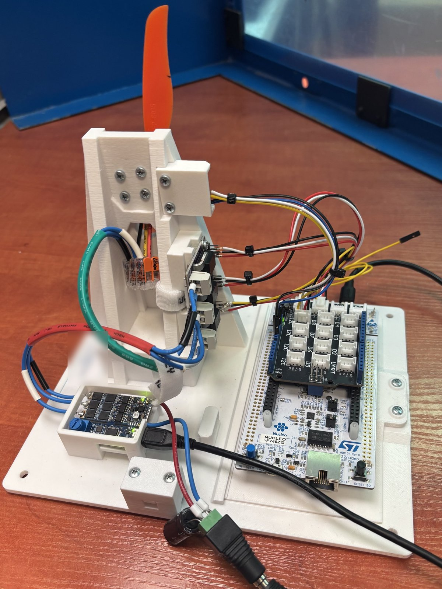

# BLDC Motor Fault Testing: MATLAB Tools

MATLAB scripts for automated fault testing of a high-speed BLDC drone motor: controlling the motor over serial, injecting faults, logging speed, phase currents and vibration, and turning the recordings into a labeled dataset.

Research internship, Poznań University of Technology, summer 2025.

*Test rig: BLDC motor with propeller on a 3D-printed stand, motor driver board and STM32 Nucleo-F746ZG data logger.*

## What it does

1. **Control the motor from MATLAB.** Talks to the motor controller over UART using the ST motor control protocol (frames captured with Motor Pilot): start, stop, set speed (positive and negative RPM), inject a fault and clear it.
2. **Log and plot.** Reads measured speed and α/β currents while the motor runs, then plots them.
3. **Acquire sensor data.** Records 3-phase currents (20 kHz) and 6-DoF IMU vibration (accelerometer + gyroscope, 1 kHz) from an STM32 data logger and saves each run to a text file.
4. **Build a dataset.** Converts the raw recordings, organized by fault number, speed and transition, into one MAT file per recording plus an index table (MAT + CSV).
5. **Generate figures.** Creates full-length and zoomed plots of current, accelerometer and gyroscope signals for every fault × speed combination (PNG, 300 dpi).

## Files

| File | Purpose |
|---|---|
| `spin_test_3.m` | Motor control test: handshake, start, speed steps, fault injection and clearing, stop |
| `run_and_plot_speed_current.m` | Run at a target RPM, log measured speed and α/β currents, plot |
| `main.m` | Live acquisition of phase currents and IMU data from the STM32 logger, with saving to file |
| `load_measurments.m` | Build the on-disk dataset (one MAT per recording + index table) |
| `bldc_load_subset_no_trim.m` | Plot every recording, full length and zoomed, and export the figures |

## Requirements

- MATLAB (R2020a or newer, uses `serialport`, `tiledlayout`, `exportgraphics`)
- Motor controller and STM32 data logger connected over USB/UART
- Set the COM port, baud rate and data folder paths at the top of each script before running

The measurement data is not included in this repository.
